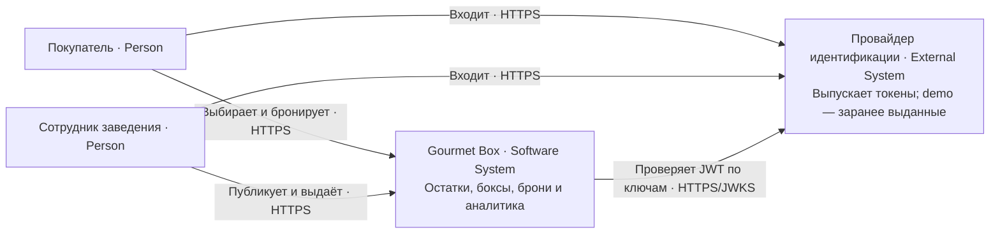
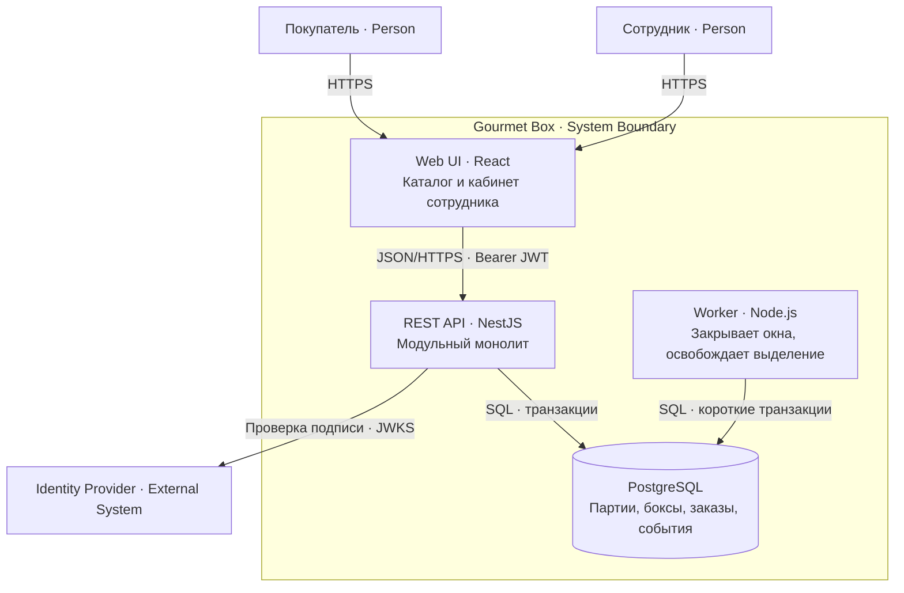
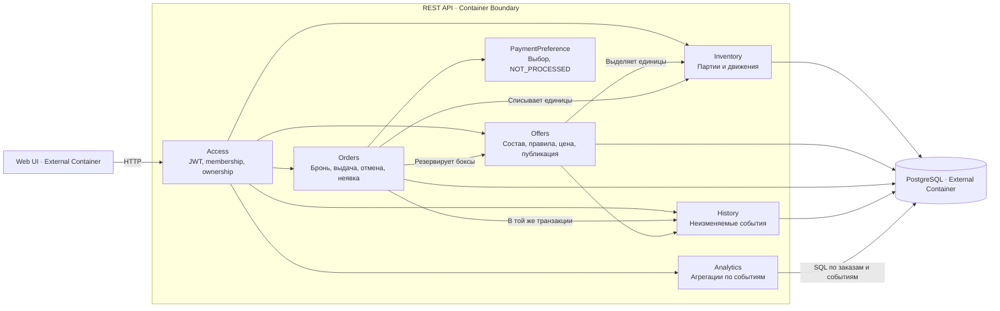

# Архитектура и C4

Обновление 20.10.2026: реализован компонент Access на NestJS, PostgreSQL repository и React-вход через Keycloak. Подробности — в [разделе авторизации](07-auth.md). Остальные компоненты остаются проектом MVP.

## Выбор архитектуры

Модульный монолит удобен для MVP: резерв и учёт продуктов требуют общей транзакции, а нагрузка ещё не подтверждает необходимость микросервисов. Предлагаемый стек: TypeScript, NestJS, PostgreSQL, React. Это выбор для будущей реализации, зависимостей приложения в этом комплекте нет.

C4 описывает четыре масштаба: контекст системы, исполняемые контейнеры, компоненты внутри контейнера и код. Здесь приведены C1–C3; C4/code стоит строить по реальному коду. «Контейнер» в C4 — отдельное приложение или хранилище, он не обязательно Docker.

Диаграммы используют обычный Mermaid flowchart с явными типами C4: его проще показывать в Markdown. Это C4-представления по смыслу, а не экспериментальный синтаксис Mermaid C4.

## C1 — контекст



Платёжного провайдера в MVP нет. Выбор оплаты сохраняется как данные брони.

## C2 — контейнеры



API и worker используют одни доменные сервисы и миграции. В demo worker можно запускать как планировщик внутри backend; в развёртывании — отдельный процесс. Redis и брокер не нужны. Пропущенный запуск worker не открывает просроченную продажу: API и каталог сами фильтруют время.

## C3 — компоненты API



Вызовы между модулями — локальные функции, без сетевых RPC. Один application service управляет всей транзакцией; вложенные сервисы получают transaction context. Запись истории не должна теряться после успешной операции.

## Структура будущего кода

```text
apps/web/                   экраны покупателя и сотрудника
apps/api/src/modules/
  access/                   проверка токена и прав
  venues/                   заведения и membership
  inventory/                партии, балансы, движения
  offers/                   боксы, pricing, публикация
  orders/                   команды жизненного цикла
  history/                  запись и чтение событий
  analytics/                SQL агрегации
apps/worker/                вызов задач закрытия
packages/contracts/         сгенерированные типы из OpenAPI
db/migrations/              схема и ограничения
docs/                       архитектура и решения
```

Внутри модуля: controller → application service → domain policy → repository. HTTP-контроллер валидирует форму запроса, доменная политика — смысл, PostgreSQL — целостность. Начать можно без абстракции repository над каждой таблицей, но доменные правила не должны жить в UI.

## Нефункциональные ориентиры

Целевой demo-набор: 100 заведений, 10 000 активных боксов, 50 одновременных пользователей. Цель p95 чтения < 500 мс, записи < 1 с на этом наборе без учёта сети; проверить нагрузочным прогоном. Это цели, а не измеренные результаты.

HTTPS, секреты вне Git, проверка issuer/audience/expiry JWT, rate limit, запрет логирования токенов и кодов выдачи. Резервное копирование PostgreSQL ежедневно; перед публичным запуском проверить восстановление. Логи имеют requestId, метрики — конфликты резерва и просроченные RESERVED. История заказов хранится по продуктовой политике; юридические сроки хранения и согласия до публичного запуска определяются отдельно.
