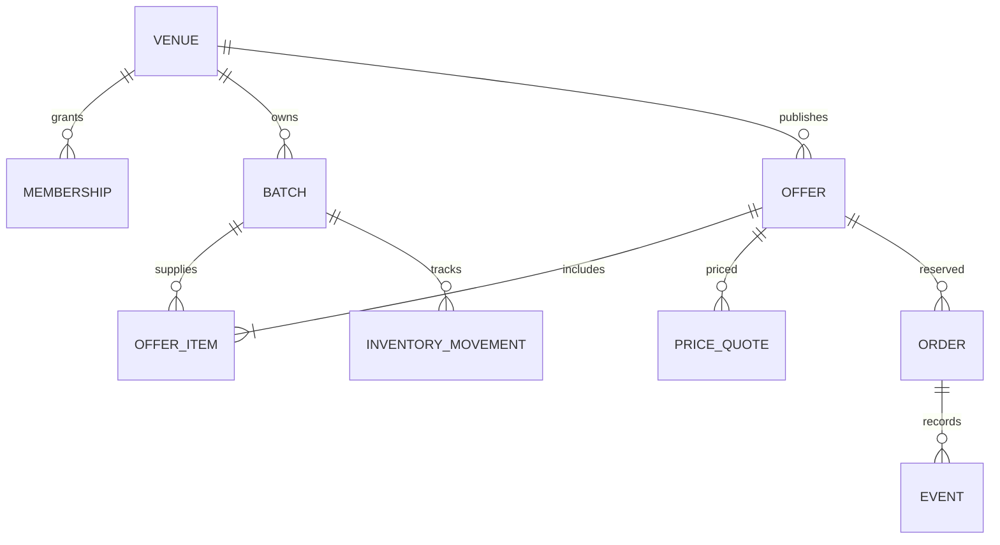
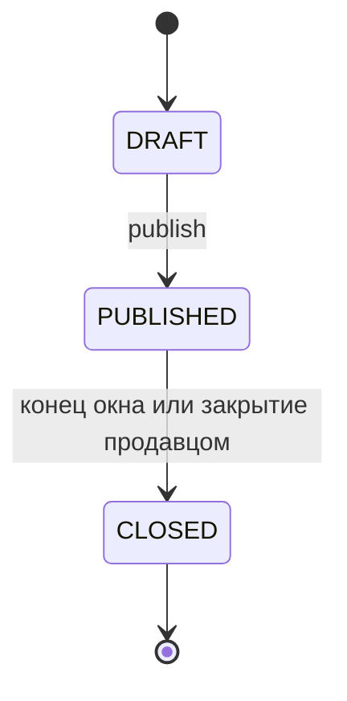
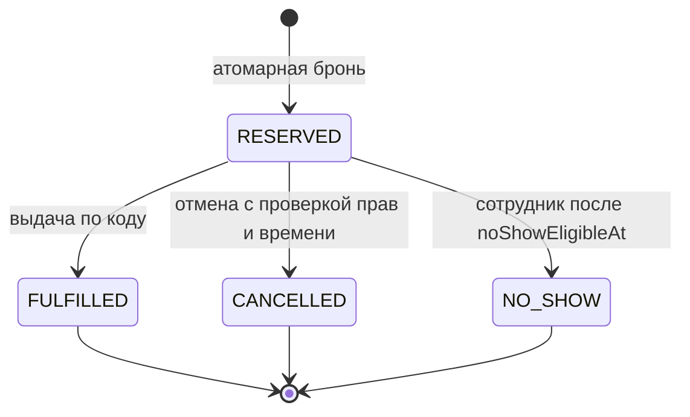
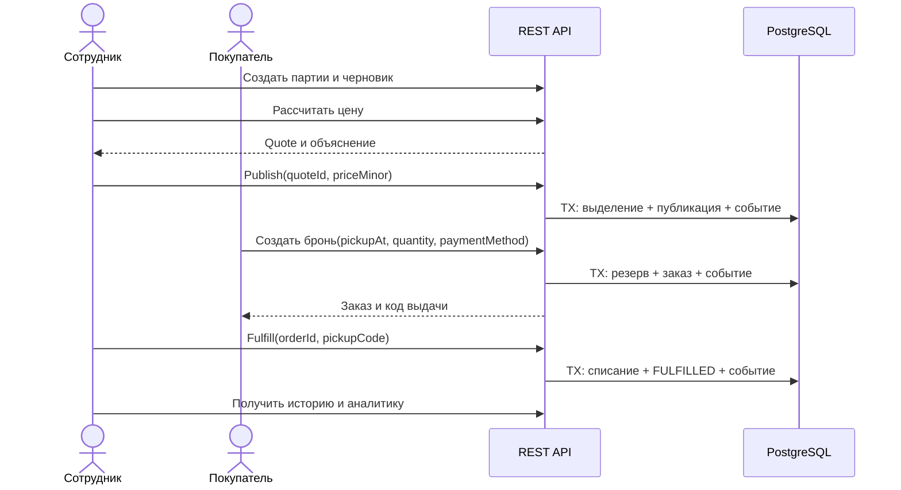

# Данные, статусы и транзакции

## Модель

| Сущность | Основные поля и смысл |
|---|---|
| Venue | id, name, address, timezone |
| Membership | userId, venueId; доступ сотрудника |
| Batch | id, venueId, name, receivedUnits, allocatedUnits, consumedUnits, expiresAt, sellByAt, originalUnitPriceMinor, storageConfirmed, allergens |
| Offer | id, venueId, title, status, version, totalBoxes, reservedBoxes, fulfilledBoxes, priceMinor, originalPriceMinor, pickupWindowStart/End |
| OfferItem | offerId, batchId, unitsPerBox; снимок названия, аллергенов, срока и исходной цены |
| PriceQuote | id, offerId, draftVersion, calculatedAt, expiresAt, ruleVersion, originalPriceMinor, recommendedPriceMinor, discountPercent |
| Order | id, buyerId, offerId, quantity, pickupAt, noShowEligibleAt, status, paymentMethod, paymentStatus, pickupCodeHash, pickupCodeEncrypted, снимок состава и цен |
| Event | id, venueId, aggregateType/id, type, actorId, occurredAt, reason, payload |
| InventoryMovement | batchId, offerId, orderId?, units, type, occurredAt; журнал выделения, освобождения и списания |
| IdempotencyRecord | actorId, operation, key, requestHash, responseStatus/body, expiresAt |

Партии неизменяемы после создания в MVP: ошибочную партию не используют, создают новую. Неиспользованное физическое количество не означает пригодность к продаже — сроки проверяются независимо. Складские списания испорченных продуктов вне сценария MVP.

## Инварианты остатков

Batch.freeUnits = receivedUnits − allocatedUnits − consumedUnits ≥ 0. Allocated включает продукты под свободные и забронированные боксы, consumed — фактически выданные. На публикации allocated += unitsPerBox × totalBoxes; выдача переводит соответствующее количество из allocated в consumed. Отмена/неявка открытого бокса уменьшает reservedBoxes, но не allocated: набор снова доступен для брони.

На закрытии выделение для свободных боксов освобождается. Продукты под RESERVED остаются allocated до конечного действия продавца, даже после конца окна. При последующей отмене или неявке закрытого бокса их allocated уменьшается. Повторное закрытие не освобождает одно и то же дважды: движения имеют уникальный ключ причины. Закрытие прекращает новые брони; существующие можно выдать только до конца окна.

Для открытого бокса allocated на партию = unitsPerBox × (totalBoxes − fulfilledBoxes). Для закрытого — unitsPerBox × reservedBoxes. Эта формула применима к сумме выделений конкретного бокса, а не ко всему batch, который может участвовать в нескольких боксах.

## Статусы

## Транзакционные алгоритмы

Единый порядок блокировок: Offer → Order (если есть) → Batch по возрастанию id. Создание брони блокирует Offer до проверки availableBoxes; закрытие и выдача используют тот же порядок. Публикация блокирует Offer, затем все Batch по id. Уровень READ COMMITTED с SELECT FOR UPDATE достаточен при соблюдении этих правил всеми командами.

1. Publish: блокировки → проверка DRAFT/version, quote/draftVersion/TTL, сроков и доступности партий → выделение → PUBLISHED, снимки и цена → событие → commit.
2. Reserve: блокировка Offer → проверка статуса, времени и доступности → увеличение reservedBoxes → создание Order со снимками и кодом → событие → commit. Код возвращается только владельцу; сотрудник вводит сообщённый покупателем код. Храним salted hash, ограничиваем попытки выдачи.
3. Fulfill: Offer → Order → Batch → RESERVED, окно, сверка кода → reservedBoxes -= quantity, fulfilledBoxes += quantity → allocated -= units, consumed += units → FULFILLED + событие → commit. Код проверяется по hash. Для повторного показа владельцу хранится зашифрованная копия с ключом вне БД; сотруднику API код не раскрывает. Статусы и TTL ограничивают срок его применения.
4. Cancel/No-show: Offer → Order → при CLOSED также Batch → проверка перехода и времени → reservedBoxes -= quantity → при CLOSED освобождение выделения → конечный статус + причина + событие → commit.
5. Close: Offer → Batch → PUBLISHED → CLOSED → освобождение свободного выделения → событие. Активные заказы остаются RESERVED.

Сбой до commit откатывает всё. Ошибка записи события тоже откатывает команду. Внешних вызовов внутри транзакций нет.

## Повторные запросы и конфликты

Каждый POST требует Idempotency-Key (UUID). Ключ scoped по actorId и operationId. При одинаковом ключе и теле возвращаем сохранённый ответ без повторного эффекта; другое тело — 409 IDEMPOTENCY_CONFLICT. Параллельные запросы с одним ключом сериализуются уникальным ограничением. Успешный ответ и ключ сохраняются в той же транзакции, TTL — 24 часа. После истечения TTL конечные состояния всё равно защищают от повторной выдачи; создание новой брони с просроченным ключом может создать новый заказ.

PATCH черновика требует expectedVersion. Любое изменение увеличивает version и делает старый quote непригодным. Несовпадение — 409 VERSION_CONFLICT. Времена считаются по серверу. Ошибки: 400 формат, 401 отсутствие токена, 403 роль, 404 отсутствие ресурса или чужой объект, 409 состояние/остаток/версия, 422 нарушение бизнес-правила, 429 ограничение частоты.

## Успешный сценарий

Индексы: orders(buyer_id, created_at, id), orders(venue_id, pickup_at, id), orders(venue_id, status), events(venue_id, occurred_at, id), offers(venue_id, status, pickup_window_end), memberships(user_id, venue_id) UNIQUE. История и каталоги используют cursor pagination по (created_at, id); сортировка фиксирована по убыванию, курсор непрозрачен. Агрегации для MVP выполняются SQL без отдельного хранилища.
