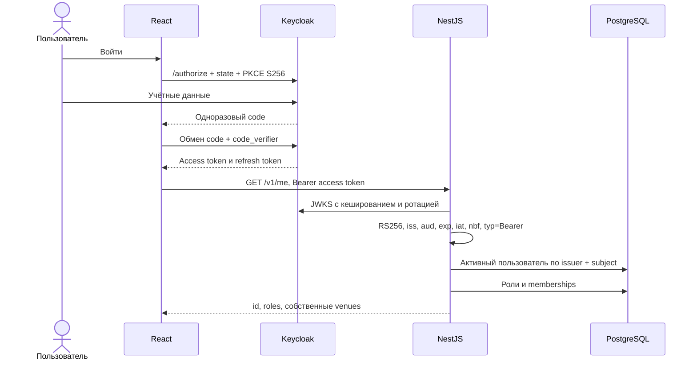

# Реализованная авторизация

20.10.2026. Реализация Access из C4: вход и выпуск JWT выполняет внешний Keycloak, NestJS — Resource Server. Пароли приложение не принимает. Регистрация и восстановление доступа остаются у провайдера.

## Вход



OIDC SDK проверяет state и callback. Public client без client secret, запрещены implicit flow, password grant и wildcard redirect URI. PKCE verifier/state временно хранятся в sessionStorage, токены — только в памяти. Перезагрузка требует нового redirect через SSO. Callback — `/callback`, выход — корень приложения. Секреты и токены не логируются.

API ожидает Keycloak access token с payload typ=Bearer и обязательными sub/iss/aud/exp/iat. iat из будущего отклоняется. Алгоритм только RS256; JWKS из конфигурации, не из JWT jku/x5u. OIDC_ISSUER должен точно совпасть с iss, аудитория — gourmet-box-api, origin JWKS совпадает с issuer. Для другого провайдера адаптировать проверку типа токена; ID tokens API не принимает. В production разрешён только HTTPS.

## Полномочия

JWT подтверждает личность. `app_users(issuer, subject)` связывает её с внутренним UUID. Роли BUYER/STAFF, active и memberships хранятся в PostgreSQL и проверяются при каждом запросе. У токена нет права назначить роль. Пользователи заранее создаются seed или оператором, как разрешено для demo. API самоназначения STAFF и списка чужих аккаунтов нет.

`orders` и `offers` в первой миграции содержат только identity/scope поля. Это не полноценные бизнес-модели. Следующие миграции расширяют эти же таблицы. buyerId при создании заказа берётся из `req.principal.id`, а не из JSON.

| Политика | Операции | Условия |
|---|---|---|
| public | getVenue, listOffers, getOffer, health | Без токена; фильтрация черновиков — задача бизнес-сервиса |
| authenticated | getMe | Валидный JWT и активный локальный пользователь |
| buyer | listMyOrders, createOrder | BUYER; SQL списка ограничен текущим buyer_id |
| venue | listBatches, createBatch, listVenueOffers, createOffer, updateDraft, quotePrice, publishOffer, closeOffer, listVenueOrders, listVenueEvents, getAnalytics | STAFF + membership; при offerId также проверяется принадлежность бокса venueId |
| order-read | getOrder, listOrderEvents | Владелец с BUYER или STAFF своего заведения |
| order-cancel | cancelOrder | Те же права; время отмены и RESERVED проверяет будущий доменный сервис |
| order-staff | fulfillOrder, markNoShow | Только STAFF заведения заказа |

Чужой объект — 404, неподходящая роль на разделе — 403, отсутствующий/невалидный JWT — 401. Без декоратора или с неизвестной операцией доступ закрыт. Error содержит requestId, без стека и токенов. GET /me не возвращает чужие аккаунты, контакты, внешние claims или коды выдачи. Ответы no-store.

## Подключение контроллеров

```typescript
@Get('venues/:venueId/orders')
@OperationAccess('listVenueOrders')
listOrders(@Req() req: AuthRequest) {
  return this.orders.listForVenue(req.params.venueId);
}
```

Guard отвечает за права. Сроки продуктов, idempotency, статус/время выдачи и остатки остаются доменной логикой. В будущих командах повторить membership/ownership в транзакции, чтобы отзыв между guard и commit не предоставлял доступ. SQL всегда ограничивается нужным venue_id/buyer_id. Нереализованные бизнес-маршруты возвращают обычный 404; тестовых probe-маршрутов в production нет.

## Настройки и ограничения

Запуск — в корневом README. Compose привязан к loopback; случайные пароли не попадают в Git. Keycloak start-dev со встроенным хранилищем предназначен для локальной демонстрации. Production: отдельный провайдер с PostgreSQL, HTTPS, политиками аккаунтов и backup. API сейчас также слушает loopback; адрес для контейнера/прокси задавать явно при развёртывании.

CORS разрешает один WEB_ORIGIN и не заменяет авторизацию. Лимит API — 120 запросов/минуту/IP в одном процессе; за доверенным прокси требуется явно настроенный trust proxy, при нескольких экземплярах — общий rate-limit store. Ограничения входа также настраиваются у провайдера. Logout не отзывает уже скопированный access token мгновенно: demo TTL 5 минут; active и memberships проверяются заново.

GET /me — минимальное расширение исходного контракта для текущего доступа; GET /health проверяет процесс. Idempotency-Key этим GET не нужен.

Источники: [Nest Guards](https://docs.nestjs.com/guards), [Keycloak Docker](https://www.keycloak.org/getting-started/getting-started-docker), [realm import](https://www.keycloak.org/server/importExport), [oidc-client-ts](https://authts.github.io/oidc-client-ts/), [jose](https://github.com/panva/jose).
